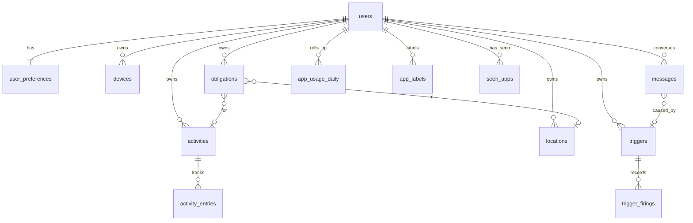

# Data model

All tables in Postgres; see `db/migrations/0001_baseline.sql` for the authoritative DDL. Every user-owned table has `user_id` with `ON DELETE CASCADE`, so `DELETE /users` removes everything.

| Table | Purpose | Notable columns |
|---|---|---|
| `users` | identity + credentials | `phone_number` unique, `password_hash` (bcrypt), optional `email`/`username` unique |
| `user_preferences` | one row per user, created lazily | `timezone`, `strictness` 0..1, `interrupt_budget_per_day`, `quiet_hours {start,end}`, `voice`, `delivery_channel` |
| `devices` | registered agents | `platform` enum, `push_token`, `last_seen_at`; id may be client-supplied for idempotent re-registration |
| `activities` | the positive side ("Building Jiko", "Gym") | |
| `activity_entries` | time spent; open entry = `end_time IS NULL` | `logged_by`/`ended_by` enum user/system/trigger, generated `duration_minutes` |
| `locations` | named geofences | `latitude`, `longitude`, `radius_m`; `geog` maintained by trigger, GIST index; `ST_DWithin` for containment |
| `obligations` | why Jiko may interrupt | `kind` task/event/goal, `due_at` / `start_at`+`end_at` / `target_minutes`+`timeframe_days`, `intervention_level`, `completed`, `source` |
| `triggers` | rules | `kind`, `match` JSONB, `condition` JSONB, `actions` JSONB, `cooldown_seconds`, `next_run_at` (scheduled), `last_fired_at`, `fire_count` |
| `trigger_firings` | audit of every fire | `context` (event + matched app/location/obligation), `results` (per-action) |
| `messages` | the conversation | `direction`, `channel`, `status` queued/sent/delivered/failed/received, `trigger_id`, `reply_to_id`, `metadata.counts_as_interrupt` |
| `app_usage_daily` | durable rollup per user/day/device/app | `seconds`, `opens`; day is in the user's timezone at ingest time |
| `app_labels` | per-user app classification | `label` distracting/work/neutral |
| `seen_apps` | catalogue for the labelling UI | `first_seen`, `last_seen` |
| `schema_migrations` | applied migration names | |

## What is *not* in Postgres

The last hour of raw sync payloads (`AppUsageData`, `HealthData`, last 5 `LocationData`) lives in memory per process (`src/data/*Manager.ts`). Conditions read from there because they need per-session granularity that the daily rollup drops. Restarting the server loses that hour; the rollup and everything else survives.

## Timezones

All `TIMESTAMPTZ`. "Today" for budgets, quotas, summaries, and quiet hours means the user's `preferences.timezone`, computed in `src/services/triggers/time.ts` with `Intl` (no library).
